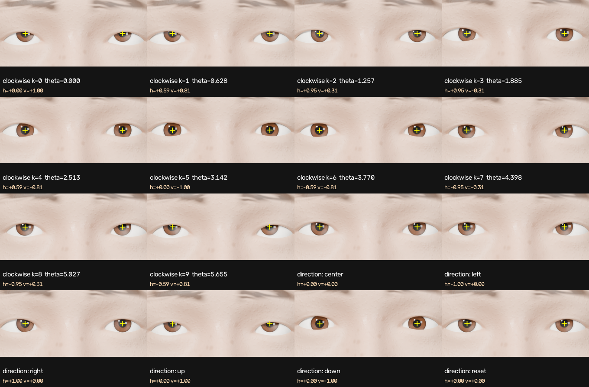

# Track 1: Synthetic Eye Movement & Virtual Camera Rendering

Samsung PRISM XR Hackathon 2026 · XR Perception Group

A textured **Google GNM Head v3** in Blender, with true 3D spherical eyeball rotation about each eyeball's own centre, coordinated eyelids and eyebrows, a locked calibrated camera, and a Python wrapper that renders 1024×1024 frames with per-frame ground-truth JSON.



## 1. Requirements

- **Blender 4.5 LTS** (tested 4.5.10, Windows 11). Download: https://www.blender.org/download/lts/4-5/ . Nothing else is needed to run the wrapper (it only uses Blender's bundled Python, `bpy` and numpy).
- CPU rendering works anywhere. Set the `BLENDER` environment variable if Blender isn't on your PATH.
- Docker alternative: see section 6.

## 2. Quick start (3 commands)

```bash
git clone <this repo> && cd <repo>
blender -b scene.blend -P wrapper/eyes.py -- clockwise      # -> renders/frame_00..09.png + metadata.json
blender -b scene.blend -P wrapper/eyes.py -- directions     # -> renders/directions/{center,left,right,up,down,reset}.png + directions.json
```

Or, from any Python: `python run.py --clockwise`, `python run.py --input left`, `python run.py --all`.

## 3. Wrapper API (`wrapper/eyes.py`)

```python
# inside Blender (Scripting tab, or:  blender scene.blend -P your_script.py)
import sys; sys.path.insert(0, "wrapper"); import eyes
eyes.move(h, v)          # h, v in [-1, +1]; both eyeballs rotate about their centres and fixate the target; returns the metadata record
eyes.reset()             # centre reset (== move(0, 0)), both eyes converge on the 35 cm target
eyes.render("out.png")   # 1024x1024 PNG from the locked camera; returns the metadata record
eyes.set_texture("set_03")                 # swap skin + eye texture set
eyes.set_lids(openness_L=1.0, openness_R=1.0)
```

CLI tasks (`blender -b scene.blend -P wrapper/eyes.py -- <task> [flags]`):

| Task | Output |
|---|---|
| `clockwise` | 10 renders at θk = 2πk/10 (h = sin θk, v = cos θk, starting at the top, clockwise in the image) + `metadata.json` |
| `directions` | Center, Left, Right, Up, Down, Reset renders + `directions.json` |
| `move H V --out f.png` | one custom render, record printed |
| `video --input left\|right\|generate` | `videos/<input>.mp4` (10 s, 24 fps) + per-frame `.json` of gaze and eyelid openness |
| `textures` | one portrait render per texture set → `renders/textures/set_XX.png` |

Flags: `--samples N`, `--fast` (24 spp), `--convention image|subject`, `--set set_03`, `--seed N`, `--duration S` (≤ 15), `--video-res PX`.

## 4. Calibration and conventions (all fixed, all verified at runtime)

| Item | Value |
|---|---|
| Units | metres |
| World frame | eye midpoint = origin, **head faces −Y**, up = +Z; subject's left eye at +X (image right) |
| Fixation target | `T(h,v) = (0.05·h, −0.35, 0.05·v)`: **35 cm** forward of the eye midpoint, ±5 cm bounds, `h,v` clamped to [−1,1] |
| Camera `CalibCam` | at `(0, −0.40, 0)`, looking +Y, **40 cm** from the eye midpoint, locked; 100 mm lens, 36 mm sensor |
| Output | **1024×1024 PNG**, constant lighting (3 static area lights + flat world, nothing animated) |
| Left / Right | default convention `image`: `h>0` moves the pupils toward the **image right**, `v>0` up. `--convention subject` flips h |
| Eye rotation | shortest-arc (Listing's-law) rotation from straight-ahead gaze onto eye→target; each eye aims at the same target, so there is natural convergence (about 5.1° per eye at reset) |
| `eye_rotation_L/R` | Euler XYZ in **radians**, world frame, relative to the primary (−Y) gaze; quaternions in `extra` |
| `pupil_center_2D_*` | geometric pupil centre (13 mm from the eyeball centre along the gaze) projected with the OpenCV-convention matrix `P = K[R|t]` (`camera_matrix`, 3×4) |

The wrapper raises `camera moved: calibration violated` if the camera or render size is changed.

`metadata.json` is a JSON array of records with exactly the keys on Samsung's slide 7 (`frame, theta, input{h,v}, eye_rotation_L/R, pupil_center_2D_L/R, camera_matrix`), plus an `extra` object (image path, convention, quaternions, gaze vectors, K/R/t, eyelid openness, texture set, Blender version).

## 5. What is in the repo

```
scene.blend                  textured GNM head, eye bones (eye.L/eye.R), materials, camera, lights, Timeline action EXPR_NaturalLook
wrapper/eyes.py              API + CLI.   gaze.py camera.py motion.py tasks_extra.py config.py
renders/                     10 clockwise frames, directions/, textures/ (one render per texture set), contact_sheet.png
metadata.json                per-frame ground truth
videos/                      left.mp4  right.mp4  generate.mp4   (+ .json traces)
textures/set_01..08_*/       GNM-UDIM texture sets: face.1001.png (skin), face.1002/1004.png (L/R eyeballs, different irises), roughness/normal
tools/                       offline pipeline + QA (not needed to run the wrapper)
run.py  Dockerfile  requirements.txt
```

**Open the scene in Blender:** press Space on the Timeline to play `EXPR_NaturalLook` (saccades, an upward eye roll, blinks, eyelids, eyebrows and pupil size). The Eye bones are `eye.L` and `eye.R` (Damped Track onto the `GazeTarget` empty). Eyelids follow vertical gaze through drivers that use simple expressions only, so they work with "Auto Run Python Scripts" off.

**Texture sets:** 8 sets in Google GNM's UDIM UV layout (1001 skin, 1002/1003 left eye, 1004/1005 right eye, 1006 teeth+gums, 1007 tongue), named as GNM's own `face.<UDIM>.png`, so they drop onto a plain GNM head. All textures are procedurally generated by us (`tools/make_textures.py`, CC0). Each set has a distinct skin and different left/right irises.

## 6. Run with Docker (CPU)

```bash
docker build -t eyes .
docker run --rm -v "$PWD/out:/work/out" eyes --clockwise
docker run --rm -v "$PWD/out:/work/out" eyes --input generate
```

## 7. Rebuilding the assets from source (optional)

```bash
python -m venv .venv && .venv/Scripts/pip install -r requirements.txt     # + GNM, see requirements.txt
python tools/export_gnm.py            # GNM v3 head -> assets/gnm_neutral.npz (world frame)
python tools/make_shapekeys.py        # eyelid / brow / pupil shape keys
python tools/make_textures.py         # 8 texture sets
blender -b --python tools/build_scene.py     # -> scene.blend
python tools/qa_pupil_check.py --dir renders/directions    # independent OpenCV direction check
python tools/validate_submission.py                         # bundle checks
python tools/contact_sheet.py                               # -> renders/contact_sheet.png (README image)
```

## 8. Verification we ran

- `tests/test_math_in_blender.py` (run with `blender -b --python`): clockwise table, gaze geometry and camera projection.
- `tools/qa_pupil_check.py`: detects the pupils in the rendered PNGs with OpenCV and checks Left / Right / Up / Down / Reset (5 of 5 must pass).
- `tools/validate_submission.py`: layout, 1024² RGB PNGs, metadata keys, θ/h/v formulas, calibration distances, video length ≤ 15 s, 5–10 texture sets.

## 9. Credits, licences and limitations

- Head: **Google GNM Head v3**, Apache-2.0 (https://github.com/google/GNM). Textures: generated by us. No third-party image data.
- Limitations: CPU Cycles renders take about 1–2 min per 1024² still at 64 spp. Videos use a fast profile (low samples, skin scattering off). Skin textures are procedural, not scan-based. The GNM head is bald, with painted brows and no eyelash geometry.
